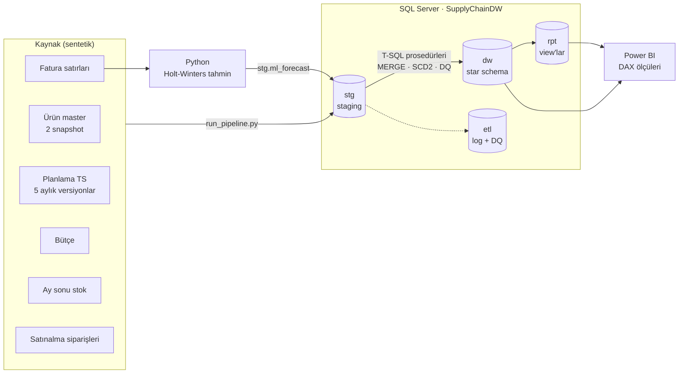
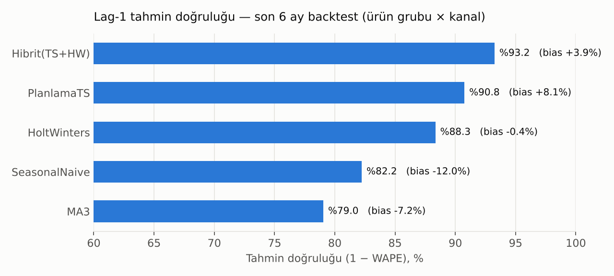
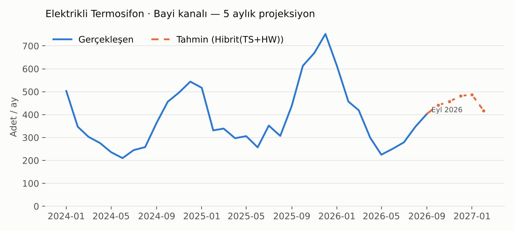

# Tedarik Zinciri Veri Ambarı ve Satış Tahminleme

**SQL Server · T-SQL · Python · Power BI**

Bir beyaz eşya üreticisinin yurt içi tedarik zinciri planlaması için uçtan uca iş zekası
çözümü: dağınık kaynak dosyalardan **star schema veri ambarı**, **T-SQL ile ETL**,
**performans iyileştirme**, **istatistiksel tahmin modeli** ve **Power BI KPI katmanı**.

> Tüm veriler `data_generator/` ile üretilmiş **sentetik** verilerdir. "Anka Ev Aletleri A.Ş."
> ve markaları kurgusaldır; gerçek bir firmanın verisi kullanılmamıştır.

---

## İş problemi

Planlama ekipleri her ay aynı soruları farklı Excel dosyalarını birleştirerek cevaplar:

- Geçen ay kesinleşen **TS (Tahmini Satış)** gerçekleşmeye göre ne kadar doğruydu, hangi yöne saptı?
- Kanal ve ürün grubu bazında **bütçe – TS – gerçekleşen** farkı ne?
- Hangi ürünlerde stok kaç aylık satışı karşılıyor (**Stok Ay**), ne kadarı 90 günü aştı?
- Dışarıdan alınan ürünlerde tedarikçiler **OTIF** hedefini (%95) tutturuyor mu?
- İstatistiksel bir model planlamacının tahminine katkı sağlar mı?

Bu proje bu raporları tek bir veri ambarından, tekrar üretilebilir ve denetlenebilir şekilde besler.

## Mimari



## Neler var?

| Alan | Uygulama | Dosya |
|---|---|---|
| Veri ambarı tasarımı | 6 boyut, 6 olgu tablosu; transaction, periodic snapshot ve accumulating snapshot olgular | [`sql/02_dw_schema.sql`](sql/02_dw_schema.sql), [`docs/data_model.md`](docs/data_model.md) |
| ETL | Staging → DW stored procedure'leri; idempotent yükleme, transaction + hata yönetimi, yükleme logu | [`sql/03_etl_procedures.sql`](sql/03_etl_procedures.sql) |
| SCD Type 2 | Ürün fiyat/statü değişiminde tarihçe; hash ile değişiklik tespiti | `etl.usp_load_dim_product` |
| MERGE | SCD1 boyutlar ve teslimat geldikçe güncellenen sipariş olgusu | `etl.usp_load_fact_purchase_order` |
| Veri kalitesi | Mükerrer satır, tanımsız kanal/ürün, yaşlandırma tutarsızlığı kontrolleri → `etl.dq_issue` | `etl.usp_load_fact_sales` |
| Raporlama katmanı | Tahmin doğruluğu (SKU bazlı WAPE + bias), bütçe kıyası, Stok Ay, yaşlandırma, OTIF | [`sql/04_reporting_views.sql`](sql/04_reporting_views.sql) |
| Performans | Columnstore, SARGable filtre, covering index, window function, Query Store | [`sql/05_performance_tuning.sql`](sql/05_performance_tuning.sql) |
| Tahminleme | Holt-Winters (numpy ile sıfırdan), mevsimsel naive, MA3; rolling-origin backtest | [`forecasting/forecast_model.py`](forecasting/forecast_model.py) |
| Power BI | Semi-additive stok, time intelligence, ay içi normalize satış, OTIF ölçüleri | [`powerbi/measures.dax`](powerbi/measures.dax) |

## Sonuçlar

### Tahmin modeli: planlamacı + model birlikte daha iyi

Son 6 kapanmış ay için, planlama TS'sinin kesinleştiği andaki bilgiyle (hedef aydan 2 ay
öncesine kadar veri) adil bir backtest yapıldı. Doğruluk ürün grubu × kanal seviyesinde
`1 − WAPE` olarak ölçüldü.



- Planlama TS'si en doğru **tekil** tahmin, ancak sistematik olarak **%8 iyimser** (fazla stok riski).
- Holt-Winters daha düşük doğrulukta ama **neredeyse yansız** (bias ≈ 0).
- İkisinin ortalaması (Hibrit) **en yüksek doğruluğu** veriyor ve bias'ı yarıya indiriyor →
  modelin planlamanın yerine değil, **yanına** konumlanması öneriliyor.



Her seri için backtest'te en iyi sonuç veren model seçilip sonraki 5 ay tahmin edilir.
Hibrit de bu seçimde adaydır: en güncel planlama TS versiyonu ile Holt-Winters tahmininin
ortalaması alınır (49 serinin 40'ında seçiliyor). Çıktı `dw.fact_ml_forecast` tablosuna
yüklenerek Power BI'da TS ile yan yana izlenir.

### Veri kalitesi

ETL, kaynak veriye bilerek eklenmiş sorunları yakalar ve yüklemeyi durdurmadan loglar:
~260 mükerrer fatura satırı elenir, tanımsız kanal kodlu 40 satır `-1 / Bilinmeyen` kanala
bağlanır, ~510 iade satırı `is_return` ile ayrıştırılır.

### Tedarikçi performansı

Hiçbir tedarikçi %95 OTIF hedefini tutturamıyor; en zayıf halka uzak doğudan ithalat yapılan
tedarikçi (genel OTIF ~%53). Bu tedarikçide 2025'in ikinci yarısındaki navlun krizi OTIF'i
~%43'e düşürüyor. `rpt.v_supplier_otif` bu kırılımı aylık ve tedarikçi bazında gösterir.

## Kurulum

Gereksinimler: Python 3.11+, Docker Desktop (veya yerel SQL Server 2019+),
[ODBC Driver 18 for SQL Server](https://learn.microsoft.com/sql/connect/odbc/download-odbc-driver-for-sql-server).

```bash
# 1) Ortam
pip install -r requirements.txt
cp .env.example .env              # şifreyi düzenleyin

# 2) SQL Server (Docker)
docker compose up -d

# 3) Veri ve tahmin
python data_generator/generate_data.py
python forecasting/forecast_model.py
python forecasting/plot_results.py

# 4) Veri ambarını kur ve yükle
python etl/run_pipeline.py --dry-run   # bağlanmadan dosya kontrolü
python etl/run_pipeline.py
```

Ardından `sql/05_performance_tuning.sql` scriptini SSMS veya Azure Data Studio'da adım adım
çalıştırıp ölçümleri [`docs/performance_notes.md`](docs/performance_notes.md) tablosuna işleyin.
Power BI Desktop'ta *SQL Server → SupplyChainDW* kaynağına bağlanıp `dw` tablolarını ve
`rpt.v_forecast_vs_actual`'ı içe aktarın; ilişkiler ve ölçüler `powerbi/measures.dax` içinde.

Testler ve lint (CI'da her push'ta da çalışır):

```bash
pip install -r requirements-dev.txt
ruff check .
pytest
```

Örnek ETL çıktısı:

```
SELECT * FROM etl.load_log ORDER BY load_id;
SELECT * FROM rpt.v_dq_summary;
SELECT TOP 20 * FROM rpt.v_forecast_accuracy WHERE lag_month = 1 ORDER BY month_start DESC;
```

## Proje yapısı

```
├── data_generator/generate_data.py   sentetik kaynak verisi (seed'li, tekrar üretilebilir)
├── sql/
│   ├── 00_create_database.sql        veritabanı, şemalar, Query Store
│   ├── 01_staging.sql                staging tabloları
│   ├── 02_dw_schema.sql              star schema
│   ├── 03_etl_procedures.sql         ETL prosedürleri + orkestrasyon
│   ├── 04_reporting_views.sql        KPI view'ları
│   └── 05_performance_tuning.sql     önce/sonra performans çalışması
├── etl/run_pipeline.py               kurulum + staging yükleme + prosedür çalıştırma
├── forecasting/
│   ├── forecast_model.py             backtest ve 5 aylık tahmin
│   └── plot_results.py               README görselleri
├── powerbi/measures.dax              DAX ölçüleri ve model ilişkileri
├── tests/                            pytest birim testleri
├── .github/workflows/ci.yml          lint + test + veritabanısız uçtan uca kontrol
├── docs/                             veri modeli, performans notları, görseller
└── data/sample/                      her kaynak dosyadan ilk 200 satır
```

## Yol haritası

- [ ] Staging yüklemesini SSIS paketi / Azure Data Factory pipeline'ı olarak yeniden kurmak
- [ ] SSAS Tabular model ve MDX/DAX ile OLAP katmanı
- [ ] Artımlı (incremental) yükleme: değişen fatura satırları için CDC / watermark
- [ ] Tahmin modelini SKU seviyesine indirmek ve muadil ürün ailesi geçmişini kullanmak

---

**Enes Uykun** · Endüstri Mühendisi
