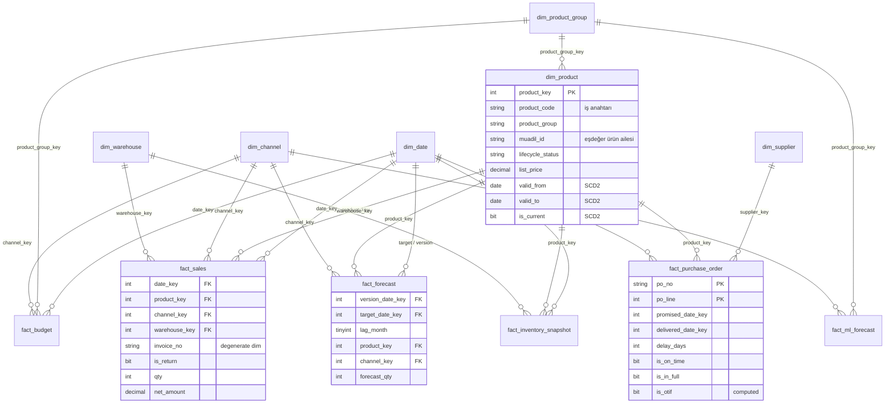

# Veri Modeli

Star schema; olgu tabloları ortak boyutları (tarih, ürün, kanal) paylaşır, böylece
satış, TS, bütçe ve stok aynı rapor üzerinde tutarlı biçimde kesişir (conformed dimensions).

## Olgu tabloları ve grain

| Tablo | Grain | Tip | Yükleme stratejisi |
|---|---|---|---|
| `fact_sales` | Fatura satırı | Transaction | Staging'deki tarih aralığını sil + ekle |
| `fact_forecast` | Versiyon ay × hedef ay × ürün × kanal | Snapshot (versiyonlu) | Gelen versiyonları sil + ekle |
| `fact_budget` | Ay × ürün grubu × kanal | Plan | Gelen bütçe yıllarını sil + ekle |
| `fact_inventory_snapshot` | Ay sonu × ürün × depo | Periodic snapshot | Gelen snapshot tarihlerini sil + ekle |
| `fact_purchase_order` | Sipariş satırı | Accumulating snapshot | `MERGE` (teslimat gerçekleştikçe güncellenir) |
| `fact_ml_forecast` | Çalıştırma × hedef ay × grup × kanal × model | Snapshot | Gelen çalıştırma tarihini sil + ekle |

## Tasarım kararları

- **SCD Type 2 ürün boyutu.** Liste fiyatı ve yaşam döngüsü statüsü zamanla değişir.
  Temmuz 2025 öncesi satışlar eski fiyat/statüye, sonrası yenisine bağlanır; geçmiş
  raporlar "o günkü" ürün bilgisiyle tekrar üretilebilir. Değişiklik, kolonların
  SHA-256 hash'i karşılaştırılarak tespit edilir.
- **Bütçe ürün grubu seviyesinde.** Bütçe SKU bazında yapılmadığı için ayrı bir
  `dim_product_group` boyutu var; ürün boyutu da bu boyuta bağlı. Böylece bütçe ile
  SKU bazlı satış aynı grup seviyesinde kesişir.
- **Unknown member (-1).** Eşleşmeyen kodlar olgudan düşürülmez; toplam tutarlar kaynak
  sistemle mutabık kalır, sorunlu satırlar `etl.dq_issue` üzerinden izlenir.
- **Lag kolonu.** `fact_forecast.lag_month` tahminin kaç ay önceden yapıldığını tutar;
  "1 ay önceki TS'ye göre doğruluk" gibi planlama KPI'ları doğrudan filtrelenebilir.
- **OTIF kuralı.** Teslim söz verilen tarihin ±1 günü içinde (rampa randevu disiplini)
  ve sipariş miktarı kadar ise satır OTIF sayılır; `is_otif` hesaplanmış (persisted) kolon.

## Power BI ilişkileri

| Boyut | Olgu | Not |
|---|---|---|
| `dim_date[date_key]` | `fact_sales[date_key]`, `fact_budget[date_key]`, `fact_inventory_snapshot[date_key]` | |
| `dim_date[date_key]` | `fact_forecast[target_date_key]` | aktif |
| `dim_date[date_key]` | `fact_forecast[version_date_key]` | pasif, `USERELATIONSHIP` ile |
| `dim_date[date_key]` | `fact_purchase_order[delivered_date_key]`, `fact_ml_forecast[target_date_key]` | |
| `dim_product[product_key]` | `fact_sales`, `fact_forecast`, `fact_inventory_snapshot`, `fact_purchase_order` | |
| `dim_product_group[product_group_key]` | `dim_product`, `fact_budget`, `fact_ml_forecast` | |
| `dim_channel[channel_key]` | `fact_sales`, `fact_forecast`, `fact_budget`, `fact_ml_forecast` | |
| `dim_supplier[supplier_key]` | `fact_purchase_order` | |

`dim_date` tarih tablosu olarak işaretlenir. Tahmin doğruluğu ölçüleri için `rpt.v_forecast_vs_actual` ayrıca içe aktarılır.
