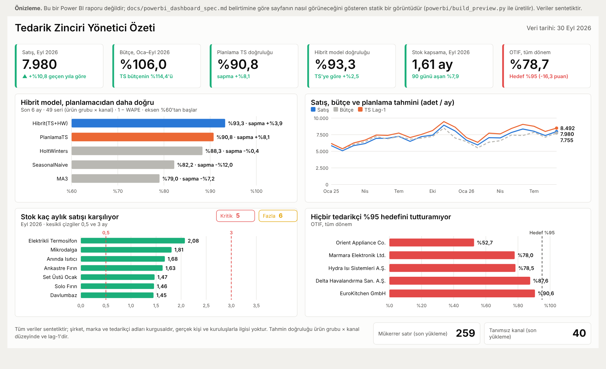

# Power BI Yönetici Özeti — Sayfa Belirtimi

Tek sayfalık yönetici özeti. Rapor dosyası (`.pbix`) repoda yok; bu belge, Power BI Desktop'ta
sayfayı kurmak için gereken her şeyi verir: hangi görsel nerede, hangi ölçü ve filtreyle, hangi
renk ve eşikle, ve kurulumdan sonra ekranda hangi sayıların görünmesi gerektiği.

Okuyucu: planlama ve tedarik yöneticisi. Sayfa şu sorulara 10 saniyede cevap verir: satış ve bütçe
nerede, tahmin ne kadar güvenilir ve model katkı sağlıyor mu, stok doğru seviyede mi, tedarikçiler
hedefi tutturuyor mu.

> Tüm veriler sentetiktir. Bu belgedeki sayılar `generate_data.py` (seed 42) ile üretilen örnek
> veriyle, SQL Server'daki `SupplyChainDW` üzerinden alınmıştır. DAX ölçüleri Power BI Desktop'ta
> henüz çalıştırılmadı; kurulumdan sonra [Doğrulama değerleri](#6-doğrulama-değerleri) tablosuyla
> karşılaştırın.

*Belirtime göre üretilmiş statik önizleme (gerçek Power BI raporu değil). Tarayıcıda açılan sürümü:
[`dashboard_preview.html`](dashboard_preview.html); `python powerbi/build_preview.py` ile yeniden üretilir.*

## 1. Veri modeli

`SQL Server → SupplyChainDW`, **Import** modu.

| Tür | Tablolar |
|---|---|
| Boyut | `dw.dim_date`, `dim_product`, `dim_product_group`, `dim_channel`, `dim_supplier`, `dim_warehouse` |
| Olgu | `dw.fact_sales`, `fact_budget`, `fact_forecast`, `fact_inventory_snapshot`, `fact_purchase_order`, `fact_ml_forecast`, `fact_ml_backtest` |
| View | `rpt.v_stock_cover` (bant dışı ürün sayıları), `rpt.v_dq_summary` (veri kalitesi) |

İlişkiler [`data_model.md`](data_model.md#power-bi-ilişkileri) içindeki tabloyla aynıdır.
`dim_date` tarih tablosu olarak işaretlenir. Ölçüler [`powerbi/measures.dax`](../powerbi/measures.dax)
dosyasından alınır; bu sayfa için yeni DAX gerekmez.

`rpt.v_stock_cover` ve `rpt.v_dq_summary` ilişkisiz, tek başına tablodur; yalnızca kendi
kolonlarıyla filtrelenir.

## 2. Tasarım

**Tuval:** 16:9, 1280 × 720 px. Kenar boşluğu 16 px, görseller arası 16 px. Özet sayfasında
**dilimleyici (slicer) yok**: OTIF kanaldan, bütçe tedarikçiden bağımsız olduğu için tek bir
dilimleyici bazı görselleri filtreleyip bazılarını filtrelemez ve yanıltır. Dilimleyiciler detay
sayfalarında.

| Rol | Renk |
|---|---|
| Sayfa zemini | `#fcfcfb` |
| Metin / ikincil metin | `#0b0b0b` / `#52514e` |
| Izgara çizgisi | `#e6e5e1` |
| Vurgu 1 (gerçekleşen, hibrit) | `#2a78d6` |
| Vurgu 2 (planlama TS) | `#eb6834` |
| Nötr (diğer modeller, bütçe) | `#b9b8b3` |
| Hedefte / iyi | `#1baf7a` |
| Dikkat | `#e0a100` |
| Hedef dışı / kötü | `#e34948` |

Yazı tipi Segoe UI. Panel başlığı 12 pt kalın, kart değeri 28 pt, etiketler 10 pt. Renk tek başına
anlam taşımaz: her değerin yanında sayı etiketi, her kartta pencere etiketi (ör. "Eyl 2026") vardır.

### Yerleşim

| # | Görsel | x | y | w | h |
|---|---|---:|---:|---:|---:|
| H1 | Başlık: "Tedarik Zinciri Yönetici Özeti" (metin kutusu) | 16 | 8 | 700 | 36 |
| H2 | Veri tarihi (kart: `Son Fatura Tarihi`, biçim `d MMMM yyyy`, sağa yaslı) | 740 | 8 | 524 | 36 |
| K1–K6 | KPI kartları, soldan sağa; x = 16 + 211·(n−1) | 16 … 1071 | 60 | 192 | 96 |
| P1 | Model karşılaştırması (yatay çubuk) | 16 | 168 | 612 | 236 |
| P2 | Satış, bütçe, planlama TS (çizgi) | 644 | 168 | 620 | 236 |
| P3 | Stok seviyesi, ürün grubuna göre (yatay çubuk) | 16 | 416 | 612 | 236 |
| P3a / P3b | Mini kartlar: Kritik / Fazla ürün sayısı (P3'ün sağ üstü) | 452 / 544 | 420 | 84 / 84 | 26 |
| P4 | OTIF, tedarikçiye göre (yatay çubuk) | 644 | 416 | 620 | 236 |
| F1 | Dipnot (metin kutusu) | 16 | 664 | 760 | 48 |
| F2 / F3 | Veri kalitesi kartları (son yükleme) | 792 / 1032 | 664 | 232 / 232 | 48 |

## 3. KPI kartları

Her kartın **kendi** zaman penceresi vardır; sayfa düzeyinde tarih filtresi yoktur. Pencere kartın
alt etiketinde yazar. Kart: "Kart (yeni)" görseli, değer + referans etiketi.

| # | Başlık | Ölçü | Filtre (görsel düzeyi) | Referans etiketi | Renk kuralı |
|---|---|---|---|---|---|
| K1 | Satış, Eyl 2026 | `Satış Adet` | `dim_date[month_start]` = 2026-09-01 | `Satış YoY %` ("geçen yıla göre") | YoY ≥ 0 yeşil, < 0 kırmızı |
| K2 | Bütçe, Oca–Eyl 2026 | `Bütçe Gerçekleşme %` | `dim_date[month_start]` 2026-01-01 … 2026-09-01 | `TS / Bütçe %` ("TS bütçeye göre") | ≥ %100 yeşil, %95–100 sarı, < %95 kırmızı |
| K3 | Planlama TS doğruluğu | `Model Doğruluk %` | `fact_ml_backtest[model_name]` = `PlanlamaTS` | `Model Bias %` ("sapma") | ≥ %90 yeşil, %80–90 sarı, < %80 kırmızı |
| K4 | Hibrit model doğruluğu | `Model Doğruluk %` | `fact_ml_backtest[model_name]` = `Hibrit(TS+HW)` | `Model Doğruluk Farkı vs TS` ("TS'ye göre fark, puan") | K3 ile aynı |
| K5 | Stok kapsama, Eyl 2026 | `Stok Ay` | `dim_date[month_start]` = 2026-09-01 | `Stok 90+ Payı %` ("90 günü aşan") | 0,5–3 ay yeşil, dışı kırmızı |
| K6 | OTIF, tüm dönem | `OTIF %` | yok | "Hedef %95" | `OTIF Hedef Rengi` ölçüsüyle (≥ %95 yeşil, altı kırmızı) |

K3 ve K4 pencere etiketi: "Son 6 ay backtest · ürün grubu × kanal". `Model Doğruluk %` ve
`Model Bias %` yalnızca **tek model** seçiliyken değer döner; model filtresi olmayan kart boş görünür.

Biçim: adet `#,0`; yüzde `0.0%`; fark `+0.0%;-0.0%`; stok ay `0.00`.

Yalnızca OTIF hedefi (%95) ve stok bandı (0,5 ve 3 ay) projenin kendi kuralıdır. Doğruluk, bütçe
ve bias eşikleri **öneridir**; kuruluşunuzun hedeflerine göre değiştirin.

## 4. Paneller

### P1 — Model karşılaştırması

- **Tür:** Kümelenmiş yatay çubuk. **Eksen:** `fact_ml_backtest[model_name]`. **Değer:** `Model Doğruluk %`.
- **Sıralama:** değere göre azalan. **Etiket:** değer, `0.0%`. **Değer ekseni:** %60'tan başlar
  (kesik eksen; alt başlıkta belirtilir: "eksen %60'tan başlar").
- **Araç ipucu:** `Model Bias %`.
- **Renk:** `Hibrit(TS+HW)` `#2a78d6`, `PlanlamaTS` `#eb6834`, diğerleri `#b9b8b3`
  (koşullu biçimlendirme, kural: model adı).
- **Başlık:** "Hibrit model, planlamacıdan daha doğru". **Alt başlık:** "Son 6 ay · 49 seri (ürün grubu × kanal) · 1 − WAPE".

### P2 — Satış, bütçe, planlama TS

- **Tür:** Çizgi. **Eksen:** `dim_date[month_start]` (tarih hiyerarşisi kapalı, sürekli eksen).
- **Değerler:** `Satış Adet` (düz, `#2a78d6`), `Bütçe Adet` (kesikli, `#b9b8b3`), `TS Lag-1` (düz, `#eb6834`).
- **Filtre:** `dim_date[month_start]` 2025-01-01 … 2026-09-01. Bütçe 2027 sonuna, TS 2026-11'e kadar
  yüklüdür; sınır konmazsa çizgiler gerçekleşenin bittiği yerden sonra da uzar ve YTD oranlar bozulur.
- **Etiket:** yalnızca son nokta. **Başlık:** "Satış, bütçe ve planlama tahmini (adet / ay)".

### P3 — Stok seviyesi

- **Tür:** Yatay çubuk. **Eksen:** `dim_product_group[product_group]`. **Değer:** `Stok Ay`.
- **Filtre:** `dim_date[month_start]` = 2026-09-01. **Sıralama:** değere göre azalan.
- **Sabit çizgiler:** 0,5 ve 3 (Analitik bölmesi, kesikli, `#e34948`).
- **Koşullu renk:** `Stok Ay` < 0,5 `#e34948`, 0,5–3 `#1baf7a`, > 3 `#e0a100`.
- **P3a** `Kritik`: kart, `rpt.v_stock_cover[product_code]` farklı sayım, filtre
  `stock_status` = `Kritik (<0,5 ay)` ve `month_start` = 2026-09-01; renk `#e34948`.
- **P3b** `Fazla`: aynı, `stock_status` = `Fazla (>3 ay)`; renk `#e0a100`.
- **Başlık:** "Stok kaç aylık satışı karşılıyor". Başlık sola yaslı ve kısa; mini kartlar sağ üst köşede.

Mini kartlar bilerek ürün (SKU) düzeyindedir: ürün grubu toplamları sağlıklı görünürken tek tek
ürünlerde bant dışı kalanlar olabilir. Örnek veride hiçbir grup 3 ayı aşmaz ama 11 ürün bant dışıdır.

### P4 — OTIF, tedarikçiye göre

- **Tür:** Yatay çubuk. **Eksen:** `dim_supplier[supplier_name]`. **Değer:** `OTIF %`.
- **Sıralama:** değere göre artan (en zayıf üstte). **Etiket:** `0.0%`.
- **Sabit çizgi:** 0,95, "Hedef %95" etiketiyle. **Renk:** alan değeriyle, `OTIF Hedef Rengi`.
- **Araç ipucu sayfası:** küçük çizgi grafik, `OTIF %` × `dim_date[month_start]`
  (`fact_purchase_order[delivered_date_key]` ilişkisiyle), fareyle üzerine gelinen tedarikçi için.
- **Başlık:** "Hiçbir tedarikçi %95 hedefini tutturamıyor". Bu başlık veriye bağlı bir iddiadır;
  veri değişirse güncelleyin ya da nötr bırakın ("Tedarikçi OTIF, hedef %95").

### Dipnot ve veri kalitesi

- **F1 (metin):** "Tüm veriler sentetiktir; şirket, marka ve tedarikçi adları kurgusaldır, gerçek
  kişi ve kuruluşlarla ilgisi yoktur. Tahmin doğruluğu ürün grubu × kanal düzeyinde ve lag-1'dir."
- **F2 "Mükerrer satır (son yükleme)":** `rpt.v_dq_summary[issue_count]` toplamı; filtreler
  `proc_name` = `etl.usp_load_fact_sales`, `issue_type` = `DUPLICATE`, `load_id` Top N → 1.
- **F3 "Tanımsız kanal (son yükleme)":** aynı, `issue_type` = `UNKNOWN_CHANNEL`.

## 5. Dikkat edilecekler

Örnek veritabanını sorgularken bulunan, sayfayı yanıltabilecek noktalar:

1. **`TS Doğruluk %` lag filtresi içermez.** `rpt.v_forecast_vs_actual` lag 0–4'ü birlikte tutar;
   filtresiz doğruluk lag'e göre %86,3 (lag 0) ile %72,1 (lag 4) arasında kayar, lag-1 %82,8'dir.
   Bu ölçüyü kullanan her görselde `lag_month` = 1 filtresi şarttır. Özet sayfa bu ölçüyü
   kullanmaz; planlama doğruluğu `fact_ml_backtest` üzerinden alınır.
2. **İki farklı doğruluk var, aynı sayfada karıştırmayın.** Backtest ürün grubu × kanal düzeyinde
   ölçer: planlama TS %90,8. `v_forecast_vs_actual` ürün (SKU) × kanal düzeyinde ölçer: aynı TS son
   6 ayda lag-1'de %82,7. Düzey inceldikçe doğruluk düşer; bu bir hata değil. Özet sayfa tek düzey
   (grup × kanal) kullanır ve dipnotta belirtir; SKU düzeyi detay sayfasında kalır.
3. **Bütçe gelecekte de yüklü** (2027-12'ye kadar). `Bütçe Gerçekleşme %` zaman sınırı olmadan
   hesaplanırsa gerçekleşme olduğundan düşük görünür. K2 ve P2'deki tarih filtresi bu yüzden zorunlu.
4. **Veri kalitesi günlüğü birikir.** Aynı yükleme iki kez çalışırsa sayılar katlanır (örnek
   veritabanında iki yükleme var: 259 + 259 mükerrer). F2 ve F3 yalnızca son yüklemeyi gösterir.
5. **`Bilinmeyen Kanal` küçük ama bozucu.** Tanımsız kanal kodlu satırlar SKU düzeyi doğrulukta
   7 adet gerçekleşen ve 0 tahminle (−%100 sapma) görünür. Detay sayfalarında kanal grafiklerinden
   hariç tutun veya dipnot düşün.
6. **Tarih filtreleri sabit.** Örnek veri 30 Eylül 2026'da biter; filtreler 2026-09-01'e sabitlenir.
   Canlı veride `dim_date[month_start]` için Top N → 1, değer olarak `Son Fatura Tarihi`
   kullanılabilir (Desktop'ta denenmedi); kısmi bir ay son ay olursa `Ay İçi Normalize Satış` ölçüsü
   devreye girer.
7. **Hibrit yalnızca lag-1 ölçüldü** ([`model_results.md`](model_results.md#sınırlar)); K4 bu sınırla okunmalı.

## 6. Doğrulama değerleri

Sayfa kurulduktan sonra ekranda şu değerler görünmelidir (örnek veri, `SupplyChainDW` sorgusu).
Fark varsa önce filtreleri, sonra ilişkileri kontrol edin.

| Görsel | Beklenen değer |
|---|---|
| K1 | **7.980** adet; YoY **+%10,8** (Eyl 2025: 7.200) |
| K2 | **%106,0** (66.265 / 62.497); `TS / Bütçe %` **%114,4** (71.500 / 62.497) |
| K3 | **%90,8**; sapma **+%8,1** |
| K4 | **%93,3**; TS'ye göre **+%2,5** |
| K5 | **1,61** ay (12.555 adet ÷ aylık ort. 7.791); 90+ payı **%7,9** (992 adet) |
| K6 | **%78,7** (kırmızı) |
| P1 | Hibrit %93,3 (+%3,9) · PlanlamaTS %90,8 (+%8,1) · HoltWinters %88,3 (−%0,4) · SeasonalNaive %82,2 (−%12,0) · MA3 %79,0 (−%7,2) |
| P3 | Termosifon 2,08 · Mikrodalga 1,81 · Anında Isıtıcı 1,68 · Ankastre Fırın 1,63 · Set Üstü Ocak 1,47 · Solo Fırın 1,46 · Davlumbaz 1,45 |
| P3a / P3b | Kritik **5** · Fazla **6** (toplam 64 ürün, 53'ü normal) |
| P4 | Orient Appliance %52,7 · Marmara Elektronik %78,0 · Hydra Isı %78,5 · Delta Havalandırma %87,6 · EuroKitchen %90,6 |
| P4 araç ipucu | Orient Appliance, 2025 ikinci yarı: **%42,6** (diğer dönemler %55,8) |
| F2 / F3 | **259** / **40** |

## 7. Detay sayfaları (isteğe bağlı)

Özet sayfa bunlara drill-through ile bağlanır; dilimleyiciler (ay, kanal, ürün grubu) yalnızca burada.

- **Tahmin detayı:** model × ay doğruluk matrisi; kanala göre planlama sapması (son 6 ay: tüm
  kanallarda +%5,8 ile +%11,6 arası iyimser, yani sistematik); SKU düzeyi `TS Doğruluk %`
  (`lag_month` = 1 filtresiyle); `ML Tahmin` ileri 5 ay (Eki 2026 – Şub 2027, 40.554 adet).
- **Stok ve tedarik:** bant dışı ürünlerin tablosu (`rpt.v_stock_cover`); yaşlandırma
  (`rpt.v_inventory_aging`, depo × 0–30 / 31–60 / 61–90 / 90+ gün); tedarikçi OTIF aylık trendi.

## 8. Kurulum sırası

1. Verileri içe aktar, ilişkileri kur, `dim_date`'i tarih tablosu işaretle.
2. Ölçüleri `measures.dax` içinden ekle (ölçü adlarını değiştirme: belirtim bu adlara bağlı).
3. 1280 × 720 tuval, renkleri tema olarak kaydet.
4. Kartları (K1–K6) kur ve [doğrulama değerleriyle](#6-doğrulama-değerleri) karşılaştır.
5. P1–P4'ü kur, sonra dipnotu ve veri kalitesi kartlarını ekle.
6. Her görsele alternatif metin yaz; sekme sırasını soldan sağa, yukarıdan aşağıya ayarla.
7. Ekran görüntüsünü `docs/img/` altına koy; README'ye ekle.

Rapor dosyasını repoya koyacaksanız sunucu adı dosyada kalır, parola kalmaz; yine de yalnızca
sentetik veriyle üretilmiş bir rapor yayınlayın ve gerçek veriye bağlı hiçbir rapor linkini paylaşmayın.
