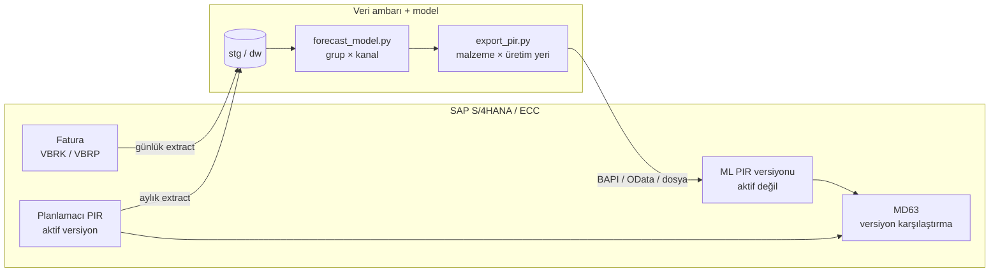

# SAP S/4HANA / ECC Entegrasyonu

Model tahmininin SAP'de planlamacının kullandığı nesneye, **Planlanmış Bağımsız İhtiyaç (PIR)**
yapısına aktarılması. Hedef sistem APO / IBP olmayan S/4HANA veya ECC.

## Yaklaşım

- Model SAP'nin **içinde değil yanında** çalışır: veriyi SAP'den alır, tahminini ayrı bir
  **PIR versiyonu** olarak geri yazar.
- Bu versiyon aktif değildir; MRP onu kullanmaz. Planlamacı MD63'te kendi versiyonuyla
  karşılaştırır, uygun gördüğünü aktifleştirir veya kendi rakamına yansıtır.
  Karar yetkisi planlamacıda kalır.
- Hibrit tahmin planlamacının girdisine bağlıdır. S/4'te hesaplanan bir key figure olmadığı için
  hibrit model servisinde hesaplanır. Bu yüzden planlamacı kendi versiyonunu güncelledikten sonra
  servis yeniden çalıştırılır.



## Seviye dönüşümü (`integration/sap/export_pir.py`)

Model **ürün grubu × kanal × ay** seviyesinde tahmin üretir. PIR ise **malzeme × üretim yeri × ay**
seviyesindedir.

| Adım | Dağıtım anahtarı | Yedek |
|---|---|---|
| Grup × kanal → malzeme | En güncel planlama versiyonundaki malzeme payları (yeni ve çıkan ürün bilgisi planlamacıda) | Son 3 ayın satış payı |
| Malzeme × kanal → üretim yeri | Son 6 ayın depo payları | Kanalın depo payları |
| Kanal toplama | PIR'de kanal yok; kanallar malzeme × üretim yeri × ay seviyesinde toplanır | — |
| Yuvarlama | Tam sayıya; her ürün grubu × ay toplamı korunur (largest remainder) | — |

**Kontroller:**

- **Satıştan kalkmış ürünler:** Hedef aydan önce satıştan kalkmış (`phaseout_date`) ürünlere
  miktar dağıtılmaz. Planlama versiyonunda bu ürünlere hâlâ miktar varsa uyarı verilir. Örnek
  veride bu 398 adet; kalkmış ürünlerin payı gruptaki aktif ürünlere aktarılıyor.
- **Eşlenemeyen kodlar:** SAP'de karşılığı olmayan bir ürün veya depo kodu sessizce düşürülmez;
  çalıştırma hata vererek durur.
- **Geçmişi olmayan seriler:** Ne planlama payı ne satış geçmişi olan seriler "dağıtılamadı"
  olarak raporlanır.

```bash
python forecasting/forecast_model.py
python integration/sap/export_pir.py --version ML
# Çalıştırma 2026-10, versiyon ML
#   Model toplamı          40,553.7
#   PIR toplamı              40,550
#   Uyarı: planlama TS'sinde satıştan kalkmış ürünlere 398 adet var; dağıtımda kullanılmadı
#   1,280 satır, 64 malzeme, 4 üretim yeri -> data/output/sap_pir_upload.csv
```

Çıktı biçimi ([örnek](../data/sample/sap_pir_upload.csv)):

| Kolon | SAP karşılığı |
|---|---|
| `material` | Malzeme (MATNR) |
| `plant` | Üretim yeri (WERKS) |
| `version` | İhtiyaç versiyonu (VERSB) |
| `period_type` | Dönem göstergesi (M = ay) |
| `period` | Dönem (YYYYMM) |
| `quantity` | Planlanan miktar |
| `base_unit` | Temel ölçü birimi |

## Kod eşlemeleri

`material_map.csv` ve `plant_map.csv` **örnek** eşlemelerdir. Gerçek malzeme numaraları ve üretim
yeri kodları repoya konmaz; repo dışındaki bir klasörde tutulur ve `SAP_MAP_DIR` ile gösterilir:

```bash
SAP_MAP_DIR=/guvenli/klasor/sap_map python integration/sap/export_pir.py
```

`integration/sap/private/` klasörü de git dışında tutulur.

## Veri alma (SAP → veri ambarı)

Staging tablolarının SAP karşılıkları:

| Staging kolonu | S/4HANA / ECC alanı |
|---|---|
| `stg.sales.invoice_no` | VBRK-VBELN |
| `stg.sales.invoice_date` | VBRK-FKDAT |
| `stg.sales.product_code` | VBRP-MATNR |
| `stg.sales.channel_code` | VBRK-VTWEG |
| `stg.sales.warehouse_code` | VBRP-WERKS (gerekirse depo yeri LGORT) |
| `stg.sales.qty` | VBRP-FKIMG; iade ve iptal belgelerinde (VBTYP) negatif |
| `stg.sales.net_amount` | VBRP-NETWR |
| `stg.forecast` | Planlamacının PIR'leri, PBIM / PBED (aktif versiyon) |

Extract için S/4HANA'da CDS view veya OData servisi, ECC'de BW extractor (2LIS_13_VDITM)
ya da RFC kullanılabilir. Staging şeması değişmediği için ETL prosedürleri aynen çalışır.

## Geri yazma seçenekleri (veri ambarı → SAP)

| Seçenek | Ne zaman |
|---|---|
| `BAPI_REQUIREMENTS_CREATE` / `BAPI_REQUIREMENTS_CHANGE` (RFC) | ECC ve S/4; en yaygın yol |
| S/4HANA PIR OData API'si | S/4HANA; SAP Integration Suite veya doğrudan HTTPS |
| Dosya + LSMW / MD61 toplu yükleme | Pilot ve ilk denemeler |

Kimlik bilgileri (RFC kullanıcısı, OData istemci sırrı) koda yazılmaz. `.env` dosyasında
(git dışı) veya şirketin sır yönetiminde tutulur.

## Devreye alma kontrol listesi

- [ ] PIR versiyon kodunu belirle; aktif olmadığını ve MRP'nin kullanmadığını doğrula
- [ ] İhtiyaç tipini ve planlama stratejisini (ör. 10 / 40) malzeme bazında doğrula
- [ ] Malzeme ve üretim yeri eşlemelerini SAP master verisinden üret (`SAP_MAP_DIR`)
- [ ] Ölçü birimlerini ve dönem takvimini (ay / mali dönem) doğrula
- [ ] Geri yazma yolunu seç (BAPI / OData / dosya) ve test sisteminde 1 ürün grubuyla dene
- [ ] Aylık zamanlama: satış extract → model → PIR yükleme → planlamacı incelemesi
- [ ] İzleme: `rpt.v_ml_model_comparison` ile model doğruluğu her ay, eşik altına düşerse uyarı
